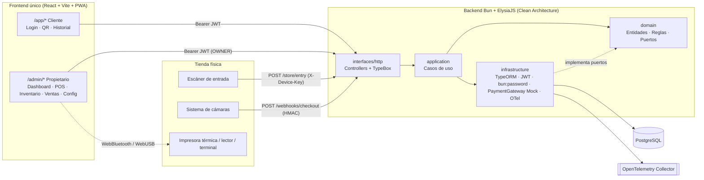
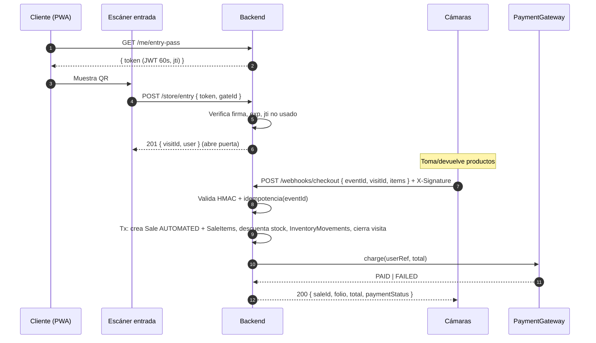

# Arquitectura y decisiones de diseño

## Contexto
Sistema de administración y POS para una tienda de abarrotes híbrida: (1) **Smart Store** — el cliente entra con un QR (JWT firmado) y, al salir, el sistema de cámaras envía un webhook que genera la venta, cobra automáticamente y descuenta inventario; (2) **POS manual** en mostrador. Estamos siguiendo Spec-Driven Design: este plan **es** la especificación a aprobar. No se escribe código de implementación en este paso.

Estado del repo: solo existe el scaffold `backend/` (Elysia "hello world"). Nada que reutilizar aún.

**Decisiones confirmadas contigo**
- Cobro automático: puerto `PaymentGateway` + adaptador **Mock** (cambiable a Stripe/MercadoPago sin tocar el contrato).
- IVA: **precio al público con IVA incluido**, **tasa por producto** (0% / 16%); el ticket desglosa base e IVA.
- Notion: vía **conector MCP** ya autenticado (no necesitas pegar tu API Key).
- Frontend: **una sola app Vite/PWA** con rutas `/app/*` (cliente) y `/admin/*` (propietario).

**Decisiones de diseño que tomé (revísalas)**
- Rol `OWNER` = ADMIN (un solo rol administrativo). El propietario inicial se crea con un *seed* (no hay registro público de OWNER).
- El QR contiene un **JWT firmado (JWS HS256) de vida corta (60 s) con `jti` de un solo uso**, regenerado en la app cada ~45 s. No se cifra (JWE) porque solo lleva el `userId`; la seguridad viene de la firma + expiración + anti-replay. Secreto separado del JWT de sesión.
- Se agrega la entidad **StoreVisit** (sesión de visita): el escáner de entrada la crea y el webhook de salida la referencia → idempotencia y trazabilidad.
- **Venta automática nunca se rechaza por stock** (la mercancía ya salió): el stock puede quedar negativo y se marca como alerta. **Venta manual sí rechaza** con `409 INSUFFICIENT_STOCK`.
- Si el cobro automático falla, la venta se registra con `payment_status = FAILED` (adeudo visible para el propietario).
- `SaleItem` guarda **snapshot** de `product_name`, `unit_price`, `unit_cost` y `tax_rate` → reportes de ganancia correctos aunque cambien precios/costos.
- Se agregan: `Category` (colores/íconos del grid del POS), `InventoryMovement` (auditoría de stock), `StoreSettings` (perfil, IVA, periféricos), `barcode` separado del SKU, `folio` legible en tickets, cancelación con reversa de stock.
- Dinero: `numeric(12,2)` en BD, `number` con 2 decimales en la API; el servidor **siempre recalcula** precios/impuestos (nunca confía en precios del cliente).
- Fórmulas: `line_total = price × qty` (IVA incluido); `line_base = round(line_total / (1 + tax_rate), 2)`; `line_tax = line_total − line_base`. `Sale.subtotal = Σ base`, `Sale.tax_amount = Σ tax`, `Sale.total_amount = Σ line_total`. **Ganancia neta** = Σ base − Σ (unit_cost × qty) de ventas `COMPLETED` (costo de compra se asume sin IVA).
- Fuera de alcance v1: devoluciones parciales, envío de ticket por email/WhatsApp, refresh tokens, multi-sucursal. La prueba de periféricos (WebBluetooth/WebUSB/ESC-POS) se hace en el navegador; el backend solo guarda su configuración.

## 2. Diagrama arquitectónico (Mermaid)

