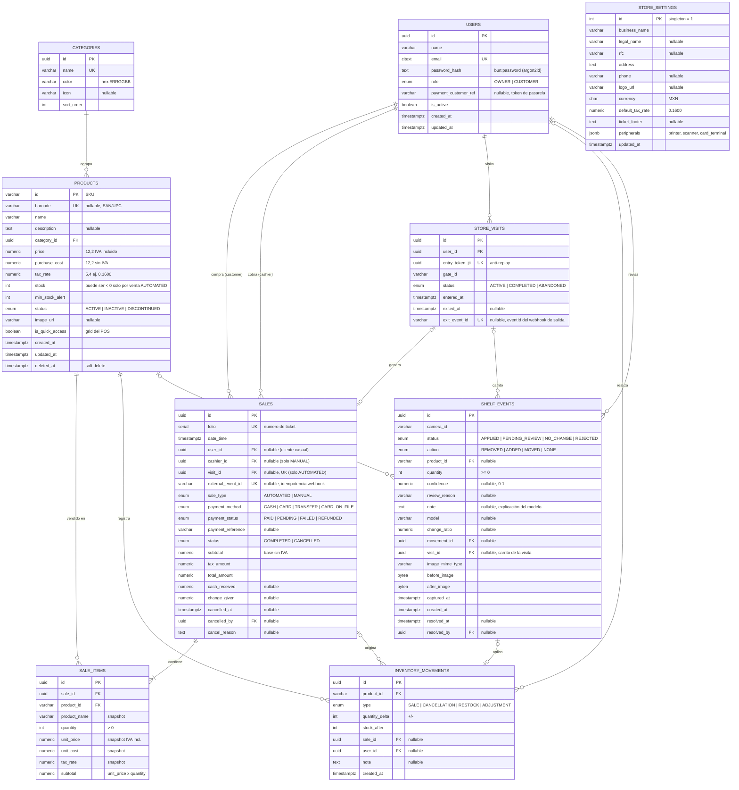

# Diagrama Entidad-Relación

Índices clave: `sales(date_time)`, `sales(user_id, date_time)`, `sale_items(product_id)`, `products(name)` (trigram para búsqueda), `products(category_id)`, `inventory_movements(product_id, created_at)`, `store_visits(user_id) WHERE status = 'ACTIVE'` (único: como máximo una visita activa por cliente), `shelf_events(status, created_at)`. Checks: `quantity > 0`, `price >= 0`, `purchase_cost >= 0`, `tax_rate BETWEEN 0 AND 1`.

